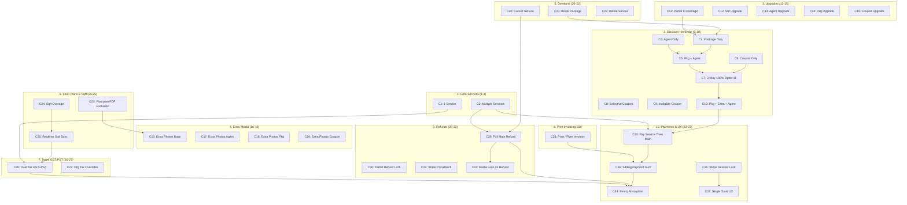
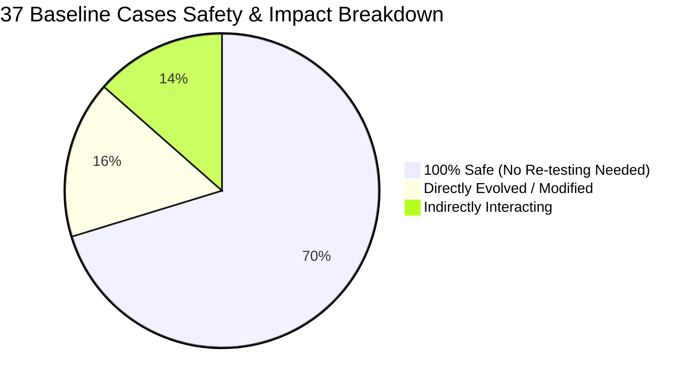

# Complete Master Map: 37 Billing & Invoice Cases with Relationship Linkages

> **Project:** BCFloor-Plans (`BCFloor-Plans` Frontend & `bcf-api` Backend)  
> **Topic:** Comprehensive Audit, Interaction Graph & Dependency Linkage Map of all 37 Invoicing, Discount, Payment & Refund Cases.  
> **Date:** November 20, 2026  
> **Status:** Fully Audited, Documented & Cross-Linked  

---

## 1. System Architecture & Case Interaction Graph

The billing and invoicing engine consists of **10 interdependent subsystems**. Changes in one subsystem (such as discounts) directly cascade into tax calculation, payment balance deduction, and refund propagation.

---

## 2. Complete Case Directory with Explicit Linkages

### Subsystem 1: Core Service Invoicing

#### Case 1: Single Service Booked (No Agent Discount)
* **Description:** Agent books 1 standalone service (e.g. Standard Photos, $166.00).
* **Expected Result:** Generates exactly 1 individual service invoice and 1 consolidated main invoice, each showing the standard catalog rate.
* **Direct Links:**
  * 🔗 **Linked to Case 26 (Taxes):** Bases GST (11%) and PST (7%) strictly on line-item tax flags.
  * 🔗 **Linked to Case 33 (Payment Engine):** Paying the single invoice satisfies the entire order.
  * 🔗 **Linked to Case 20 (Cancellations):** Canceling this single service marks the entire order void.

#### Case 2: Multiple Services Booked (No Package / Base Rates)
* **Description:** Agent books 2+ standalone services without completing a package bundle.
* **Expected Result:** Generates individual service invoices for each service plus 1 consolidated main invoice summing all line items.
* **Direct Links:**
  * 🔗 **Linked to Case 1 (Core Invoicing):** Multi-item extension of Case 1.
  * 🔗 **Linked to Case 11 (Dynamic Packages):** If subsequent services complete a package, Case 11 is triggered.
  * 🔗 **Linked to Case 33 & 36 (Payment Aggregation):** When an agent pays 1 service invoice, the main invoice must reduce its remaining balance.
  * 🔗 **Linked to Case 29 (Refund Cascade):** Refunding the main invoice cascades to refund all sibling invoices.

---

### Subsystem 2: Discount Hierarchy & Option B Selection

#### Case 3: Agent Discount Only (e.g., 15% OFF)
* **Description:** Agent has an active personal profile discount (e.g., 15%) and books services without package or coupon.
* **Expected Result:** 15% discount item appears on every service invoice and is aggregated onto the main invoice.
* **Direct Links:**
  * 🔗 **Linked to Case 5 (Pkg vs Agent):** Competes directly with Package Discount.
  * 🔗 **Linked to Case 7 (3-Way Evaluation):** Competes with Package and Coupon codes.
  * 🔗 **Linked to Case 10 (Extra Items):** Governs extra non-package services.
  * 🔗 **Linked to Case 13 & 17 (Scaled Pricing):** Discounts upgrade rates and extra photo limits proportionally.

#### Case 4: Package Discount Only (e.g., 20% OFF)
* **Description:** Agent without an agent discount books a qualified package (e.g., Photos + Drone).
* **Expected Result:** 20% package discount applies to package-eligible services; main invoice shows consolidated package discount line.
* **Direct Links:**
  * 🔗 **Linked to Case 5 (Pkg vs Agent):** Competes against Agent Discount.
  * 🔗 **Linked to Case 11 (Dynamic Package Trigger):** Automatically activated when missing package services are added.
  * 🔗 **Linked to Case 21 (Package Disband):** Deleting a service breaks the bundle and removes this discount.
  * 🔗 **Linked to Case 14 & 18 (Scaled Pricing):** Net unit rates on upgrades and extra photos reflect the 20% package savings.

#### Case 5: Package (20%) + Agent Discount (15%) Both Present
* **Description:** Agent with 15% discount books a package offering 20% discount.
* **Expected Result:** System evaluates dollar savings. 20% Package Discount ($120) wins over 15% Agent Discount ($90). Only Package Discount is applied; Agent Discount is suppressed to prevent double-discounting.
* **Direct Links:**
  * 🔗 **Linked to Case 3 & 4 (Parent Rules):** Synthesizes Case 3 and Case 4.
  * 🔗 **Linked to Case 7 (3-Way Option B):** Expands into 3-way evaluation when a coupon code is also entered.
  * 🔗 **Linked to Case 10 (Order-Level vs Service-Level):** Precursor to the extra-items scenario.

#### Case 6: Coupon Code Discount Only
* **Description:** Agent enters a promotional coupon code (e.g., `SUMMER20` for 20% off).
* **Expected Result:** Itemized as `"Coupon Discount: SUMMER20"` on qualifying services and main invoice.
* **Direct Links:**
  * 🔗 **Linked to Case 7 (3-Way Option B):** Competes against Agent and Package discounts.
  * 🔗 **Linked to Case 8 & 9 (Eligibility Filtering):** Only applies if services qualify under coupon restrictions.
  * 🔗 **Linked to Case 15 & 19 (Upgrades & Media):** Discounts upgrade increments and extra photo unit rates.

#### Case 7: Package + Agent + Coupon Code (3-Way Dollar Evaluation)
* **Description:** Agent with 15% discount books a 20% package and inputs a $100 coupon code.
* **Expected Result:** Backend calculates exact dollar savings across the entire order: `max(rawPkg, rawAgent, rawCode)`. The single highest dollar discount wins; the other two are completely stripped.
* **Direct Links:**
  * 🔗 **Linked to Cases 3, 4, 6 (Candidate Inputs):** Combines all 3 discount engines into 1 arbiter.
  * 🔗 **Linked to Case 5 (2-Way Foundation):** Directly replaces legacy 2-way evaluation.
  * 🔗 **Linked to Case 10 (Line Item Divergence):** Led to the discovery of order-level vs line-item winner differences.

#### Case 8: Coupon Code Applied to 1 Valid + 1 Invalid Service
* **Description:** Coupon is restricted to Photo services. Order contains 1 Photo service ($166) and 1 Floor Plan service ($250).
* **Expected Result:** Coupon applies exclusively to the Photo service invoice; Floor Plan service is billed at full price.
* **Direct Links:**
  * 🔗 **Linked to Case 6 & 7 (Coupon Base):** Enforces service-scoped discount mapping (`service_id` filtering).
  * 🔗 **Linked to Case 10 (Hybrid Precursor):** Demonstrates that services on the same order can have different discount states.

#### Case 9: Coupon Code Applied to Completely Ineligible Services
* **Description:** Agent applies a coupon valid only for 3D Tours on an order containing only Drone and Photos.
* **Expected Result:** Coupon resolves to $0.00 savings; fallback applies winning discount between Agent and Package (or $0.00).
* **Direct Links:**
  * 🔗 **Linked to Case 6 & 7:** Zero-value elimination in `pickWinningDiscount()`.

#### Case 10: Package + Extra Non-Package Service Booked with Agent Discount
* **Description:** Agent has 15% discount ($127.50 on $850 order) and books a 20% package ($120 on $600 package services) + $250 extra service.
* **Expected Result:** Option B winner for the whole order is Agent Discount ($127.50 > $120.00). Main invoice and ALL individual service invoices apply 15% Agent Discount. No invoice shows Package Discount.
* **Direct Links:**
  * 🔗 **Linked to Case 5 & 7 (Option B Selection):** Enforces order-level winner consistency across all child invoices.
  * 🔗 **Linked to Case 33 & 34 (Invoice Sum Matching):** Ensures sum of service invoices ($156.62 + $409.48 + $235.87) equals main invoice ($801.97) to $0.00 difference.
  * 🔗 **Linked to Future Per-Service Engine:** Directly inspired the new plan to allow Package on package items and Agent on extra items.

---

### Subsystem 3: Dynamic Updates & Plan Upgrades

#### Case 11: Fewer Services Booked Initially, Later Completed to Package
* **Description:** Agent books Standard Photos. Later, vendor or agent adds Drone Photos, satisfying the Photo Package criteria.
* **Expected Result:** `syncOrderInvoices()` detects that package requirements are now fulfilled, applies package discount to all eligible items, and updates main invoice.
* **Direct Links:**
  * 🔗 **Linked to Case 1 & 2 (Order Expansion):** Dynamic transition from single/multi services to a package.
  * 🔗 **Linked to Case 4 (Package Discount):** Activates package discount retrospectively.
  * 🔗 **Linked to Case 25 (Real-time Sync):** Triggers invoice recalculation on save.

#### Case 12: Upgrade Package / Service Option (Non-Discounted Services)
* **Description:** Agent upgrades a service from 25 Photos ($166) to 40 Photos ($220).
* **Expected Result:** Generates a difference invoice for $54.00 + taxes (or updates unpaid invoice to $220.00).
* **Direct Links:**
  * 🔗 **Linked to Case 1 & 2:** Standard option differential billing.
  * 🔗 **Linked to Case 26 (Taxes):** Assesses GST/PST on the incremental price difference.

#### Case 13: Upgrade Package / Service Option (Agent-Discounted Services)
* **Description:** Agent with 15% discount upgrades service from $166 to $220 ($54 increase).
* **Expected Result:** Agent discount of 15% applies to the $54 upgrade difference ($54 - $8.10 = $45.90 + tax).
* **Direct Links:**
  * 🔗 **Linked to Case 3 & 12 (Agent Discount + Upgrade):** Proportionally applies agent discount to the upgrade variance.

#### Case 14: Upgrade Package / Service Option (Package-Discounted Services)
* **Description:** Service inside a 20% package is upgraded to a higher tier.
* **Expected Result:** 20% package discount applies to the upgrade price delta.
* **Direct Links:**
  * 🔗 **Linked to Case 4 & 12 (Package Discount + Upgrade):** Proportionally scales package discount on option upgrade.

#### Case 15: Upgrade Package / Service Option (Coupon-Discounted Services)
* **Description:** Service with an active percentage coupon is upgraded.
* **Expected Result:** Coupon percentage discounts the price delta.
* **Direct Links:**
  * 🔗 **Linked to Case 6 & 12 (Coupon + Upgrade):** Proportionally scales coupon discount on option upgrade.

---

### Subsystem 4: Extra Media & Line Items

#### Case 16: Extra Photos on Non-Discounted Service
* **Description:** Photographer uploads 32 photos on a 25-photo package.
* **Expected Result:** Generates an `"Extra Photos (7)"` line item at catalog unit rate ($X/photo).
* **Direct Links:**
  * 🔗 **Linked to Case 1 & 2:** Increases invoice line item count and subtotal.
  * 🔗 **Linked to Case 23 (Floor Plan Safety):** Guarded so PDF uploads are never counted as photos.

#### Case 17: Extra Photos on Agent-Discounted Service
* **Description:** Photographer uploads extra photos for an agent with 15% discount.
* **Expected Result:** Unit rate of extra photos is discounted by 15%: `netRate = baseRate * (1 - 0.15)`.
* **Direct Links:**
  * 🔗 **Linked to Case 3 & 16:** Injects agent discount into `syncExtraItems()`.

#### Case 18: Extra Photos on Package-Discounted Service
* **Description:** Photographer uploads extra photos on a service inside a 20% package.
* **Expected Result:** Unit rate of extra photos is discounted by 20%.
* **Direct Links:**
  * 🔗 **Linked to Case 4 & 16:** Injects package discount into `syncExtraItems()`.

#### Case 19: Extra Photos on Coupon-Discounted Service
* **Description:** Photographer uploads extra photos on a service covered by a coupon code.
* **Expected Result:** Unit rate of extra photos is discounted by coupon rate.
* **Direct Links:**
  * 🔗 **Linked to Case 6 & 16:** Injects coupon discount into `syncExtraItems()`.

---

### Subsystem 5: Cancellations & Deletions

#### Case 20: Cancel a Service from Order
* **Description:** Vendor or Admin cancels 1 service from a multi-service order.
* **Expected Result:** Service invoice is marked `VOID`; line item is removed from main invoice; main invoice total recalculates.
* **Direct Links:**
  * 🔗 **Linked to Case 2 (Multi-Service):** Reduces active service count.
  * 🔗 **Linked to Case 21 (Package Disband):** If cancelled service was part of a package, triggers package collapse.
  * 🔗 **Linked to Case 29 & 30 (Refund Engine):** If service was already paid, triggers refund workflow instead of void.

#### Case 21: Delete a Package Service from Order (Breaking Package)
* **Description:** An order with Photo & Drone Package has Drone deleted, leaving only Photos.
* **Expected Result:** Package discount criteria no longer met $\rightarrow$ Package discount is completely revoked; remaining service reverts to catalog price (or Agent Discount if eligible).
* **Direct Links:**
  * 🔗 **Linked to Case 4 & 5 (Package Discount Rules):** Enforces minimum package service threshold.
  * 🔗 **Linked to Case 3 (Agent Fallback):** If package collapses and agent has a discount, Agent Discount takes over.

#### Case 22: Delete Any Service from Order
* **Description:** Admin permanently deletes a service line from the order edit screen.
* **Expected Result:** Associated service invoice is deleted from database; consolidated main invoice removes line and updates total.
* **Direct Links:**
  * 🔗 **Linked to Case 20 (Cancellation):** Hard deletion counterpart to soft cancellation.
  * 🔗 **Linked to Case 34 (Penny Absorption):** Re-evaluates order payment balance so no orphaned pennies remain.

---

### Subsystem 6: Floor Plans, Square Footage & Area Charges

#### Case 23: Floor Plan Uploads (Preventing Spurious Extra Photos)
* **Description:** Photographer uploads 3 architectural floor plan PDF files.
* **Expected Result:** System recognizes service category as `"floor"` / `"floorplan"` and suppresses the extra photos counter. No spurious extra photo charges are added.
* **Direct Links:**
  * 🔗 **Linked to Case 16 (Extra Media Engine):** Protects extra media logic in `FileManager.tsx` from mistaking PDFs for photos.

#### Case 24: Square Footage Based Services ($0.10/sqft + Overage)
* **Description:** Floor plan service billed at $0.10 per sqft (e.g. 2,500 sqft = $250.00) plus area charges for outbuildings.
* **Expected Result:** `os->amount` accurately stores $250.00; option unit price ($0.10) is preserved for audit; area overages generated as distinct items.
* **Direct Links:**
  * 🔗 **Linked to Case 25 (Real-time Sync):** Updates whenever square footage is edited.
  * 🔗 **Linked to Case 26 (Taxes):** Calculates provincial and federal taxes on sqft base.

#### Case 25: Real-time Invoice Sync on Square Footage Update
* **Description:** User changes property square footage in the floor plan tab from 2,000 to 3,000 sqft.
* **Expected Result:** On save, backend triggers `Invoice::syncOrderInvoices()`; frontend refetches invoices immediately without requiring a full browser refresh.
* **Direct Links:**
  * 🔗 **Linked to Case 24 (Sqft Pricing):** The data change event for Case 24.
  * 🔗 **Linked to Case 33 (Payment Preparation):** Ensures customer pays against updated sqft figures.

---

### Subsystem 7: Taxes (GST & PST Engine)

#### Case 26: Dual Tax Engine: Org GST (11%) + Service PST (7%)
* **Description:** Service A has PST enabled (11% GST + 7% PST = 18%). Service B has PST disabled (11% GST only).
* **Expected Result:** Invoices store itemized `tax_details = { GST: $X, PST: $Y }`. Main invoice aggregates GST and PST accurately without tax bleed across services.
* **Direct Links:**
  * 🔗 **Linked to Cases 1–10 (All Pricing & Discounts):** Taxes are assessed on **net discounted subtotal**.
  * 🔗 **Linked to Case 28 (Print Flyer Taxes):** Ensures print requests do not inherit incorrect tax rates.
  * 🔗 **Linked to Case 34 (Penny Discrepancy):** Root source of fractional-cent tax rounding.

#### Case 27: Organization Tax Overrides vs Service Defaults
* **Description:** Super Admin sets custom organization GST rate (e.g. 11% instead of 5%).
* **Expected Result:** System overrides federal defaults with organization-specific tax profile across all newly generated invoices.
* **Direct Links:**
  * 🔗 **Linked to Case 26:** Establishes the baseline tax percentage used by Case 26.

---

### Subsystem 8: Print Requests & Add-ons

#### Case 28: Print Request / Flyer Invoicing
* **Description:** Agent orders printed feature sheets ($94.35) after photo shoot is complete.
* **Expected Result:** Creates standalone print invoice with correct GST/PST. Paying print invoice deducts exact $94.35 from order balance (not $112.00).
* **Direct Links:**
  * 🔗 **Linked to Case 26 (Taxes):** Aligns print product tax bases with core services.
  * 🔗 **Linked to Case 33 & 36 (Payment Aggregation):** Ensures print payment reduces the main order balance.

---

### Subsystem 9: Refund Workflows & Status Synchronization

#### Case 29: Full Refund of Main Consolidated Invoice
* **Description:** Admin issues a 100% refund on the main invoice ($909.14).
* **Expected Result:** 
  1. Main invoice marked `refunded`.
  2. ALL sibling service invoices automatically updated from `paid` to `refunded`.
  3. Order payment status updated to `REFUNDED`.
  4. Order total paid set to `$0.00`, balance due set to `$0.00`.
* **Direct Links:**
  * 🔗 **Linked to Case 2 (Multi-Service Hierarchy):** Parent refund cascades to all children.
  * 🔗 **Linked to Case 32 (Media Lock):** Automatically revokes media access on refund.
  * 🔗 **Linked to Case 34 (Penny Discrepancy):** Normalizes residual `-$0.01` to `$0.00`.

#### Case 30: Partial Refund of a Paid Invoice
* **Description:** Admin refunds $100 out of a $500 invoice.
* **Expected Result:** Invoice status set to `partially_refunded`. Checkout session creation and "Pay Now" / "Pay All" buttons are permanently disabled to prevent duplicate re-payment.
* **Direct Links:**
  * 🔗 **Linked to Case 29 (Refund Hierarchy):** Partial variation of Case 29.
  * 🔗 **Linked to Case 33 (Checkout Security):** Hardens checkout against re-charging partially refunded bills.

#### Case 31: Stripe Payment Intent Fallback on Refund
* **Description:** Admin refunds an invoice whose original Stripe payment was processed in test mode or on a different Stripe account.
* **Expected Result:** When Stripe returns `PaymentIntent not found`, backend catches exception and creates an internal accounting refund ledger entry without crashing with HTTP 500.
* **Direct Links:**
  * 🔗 **Linked to Case 29 & 30:** Guarantees refund completion even during API key transitions.

#### Case 32: Media Access Revocation on Refund
* **Description:** An invoice or order is marked `refunded`.
* **Expected Result:** Listing property media access is locked (`lock_materials = true`), preventing download of high-res photos.
* **Direct Links:**
  * 🔗 **Linked to Case 29 & 30:** Security consequence of refund execution.

---

### Subsystem 10: Payment Allocation, Concurrency & Toast UX

#### Case 33: Paying Individual Service Invoices Then Main Invoice
* **Description:** Order total is $911.03. Agent pays Service 1 ($235.88). Remaining balance is $675.15. Agent then clicks "Pay All" on main invoice.
* **Expected Result:** Stripe checkout session opens for exactly **$675.15** (not $911.03). After payment, main invoice and remaining service invoices are marked `paid`.
* **Direct Links:**
  * 🔗 **Linked to Case 2 (Multi-Service Split):** Requires parent invoice to acknowledge child payments.
  * 🔗 **Linked to Case 36 (Sibling Payment Sum):** Main invoice dynamically aggregates sibling payments.
  * 🔗 **Linked to Case 34 (Penny Absorption):** Prevents $0.01 lingering balances.

#### Case 34: The $0.01 / -$0.01 Penny Rounding Discrepancy
* **Description:** Tax scaling on fractional discounts leaves $0.01 unpaid balance (e.g. Total $909.14, Paid $909.13).
* **Expected Result:** `syncOrderStatus()` absorbs residual balances $\le \$0.02$ when all services are covered, marking the order `PAID` with `$0.00` pending.
* **Direct Links:**
  * 🔗 **Linked to Case 26 (Tax Rounding):** Cures rounding errors produced by multi-tax scaling.
  * 🔗 **Linked to Case 29 (Refund Normalization):** Eliminates `-$0.01` display bugs on refunds.
  * 🔗 **Linked to Case 33 & 36:** Final step in payment completion.

#### Case 35: Duplicate Stripe Session Verification (Double Paid Amount Bug)
* **Description:** Returning from Stripe triggers multiple concurrent API verification requests from Next.js `useEffect`.
* **Expected Result:**
  * Frontend: `processedSessionIdRef` guards execution so verification runs exactly once.
  * Backend: `Cache::lock("stripe_session_lock_{$id}", 30)` prevents race conditions and duplicate `agent_payments` inserts.
* **Direct Links:**
  * 🔗 **Linked to Case 33 (Stripe Payment):** Secures the payment confirmation endpoint.
  * 🔗 **Linked to Case 37 (Toast UX):** Prevents duplicate verification toasts.

#### Case 36: Sibling Payments Without Explicit `order_service_id`
* **Description:** Agent pays via the invoice modal where Stripe metadata contains `invoice_uuid` but `order_service_id = null`.
* **Expected Result:** Backend auto-resolves `order_service_id` from the invoice's single item; main invoice aggregates all sibling payments so the remaining balance reflects the deduction immediately.
* **Direct Links:**
  * 🔗 **Linked to Case 33 (Partial Payments):** Critical mechanism enabling Case 33.
  * 🔗 **Linked to Case 28 (Print Flyer Invoices):** Ensures flyer payments credit the overall order ledger.

#### Case 37: Toast Notification Deduplication (Single Toast UX)
* **Description:** Returning from successful payment displayed 3–4 confirmation toasts simultaneously.
* **Expected Result:** Single consolidated toast displayed using Sonner loading replacement `{ id: loadingToastId }`; redundant listener toasts silenced.
* **Direct Links:**
  * 🔗 **Linked to Case 35 (Session Verification):** UX counterpart to session deduplication.
  * 🔗 **Linked to Case 33:** Polishes the final user checkout experience.

---

## 3. High-Impact Interdependency Matrix

| Primary Case | Impacted Cases | Risk / Behavior if Broken |
| :--- | :--- | :--- |
| **Case 7 (Option B 3-Way)** | Cases 3, 4, 6, 10 | If discount math fails, wrong discount applied; customer overcharged or double-discounted. |
| **Case 10 (Extra Items)** | Cases 33, 34 | If child invoices diverge from main invoice, invoice totals don't sum to main invoice ($801.97 vs $768.67). |
| **Case 21 (Break Package)** | Cases 4, 5, 11 | If package is deleted but discount remains, customer receives package discount on non-package order. |
| **Case 26 (Dual Tax)** | Cases 1–10, 28, 34 | If tax is calculated on gross instead of net discounted subtotal, customer is overtaxed and penny balance fails. |
| **Case 29 (Main Refund)** | Cases 2, 32, 34 | If main refund doesn't cascade, sibling invoices stay `paid`, locking media fails, or `-$0.01` displays. |
| **Case 33 (Pay Service Then Main)** | Cases 35, 36, 34 | If sibling payments aren't summed, Stripe charges full original amount instead of remaining balance. |
| **Case 35 (Session Lock)** | Cases 33, 36, 37 | If concurrent locks fail, customer payment is recorded twice, showing double paid amount in billing. |

---

## 4. Subsystem 11: Unsolved / Special Evolution Cases (Cases 38–45)

These cases represent the next-generation **Per-Service Best Discount Engine (Line-Item Maximum Savings)**. Under this model, instead of forcing the whole order into a single discount type, every single line item independently receives the highest discount it qualifies for (`max(Package, Agent, Coupon)`), and the consolidated invoice groups and itemizes them accordingly.

#### Case 38: Inverted Package vs Agent Rate (Agent > Package)
* **Status:** ⚠️ **Special Case / Planned Implementation**
* **Scenario:** Package offers 15% discount ($24.90 on $166), but Agent has a 20% profile discount ($33.20 on $166). No extra services.
* **Expected Result:** Rather than locking into 15% package pricing, the arbiter applies the higher **20% Agent Discount** to the package services. Customer always receives the maximum savings.
* **Direct Links:**
  * 🔗 **Evolves Case 4 & 5:** Directly inverts traditional package priority when an elite agent discount exceeds the package tier.

#### Case 39: Hybrid Package (20%) + Extra Item with Agent Discount (15%)
* **Status:** ⚠️ **Special Case / Planned Implementation**
* **Scenario:** Agent books a 2-service package (Photos $166 + Drone $434 = $600 with 20% package discount = $120.00) plus an extra non-package service (2D Floor Plans, $250). Agent discount is 15%.
* **Expected Result:**
  * Package services (Photos & Drone) receive **20% Package Discount** (-$120.00).
  * Extra service (Floor Plans) receives **15% Agent Discount** (-$37.50).
  * Main invoice itemizes both: `Package Discount (-$120.00)` and `Agent Discount (-$37.50)`. Total savings = **-$157.50**.
* **Direct Links:**
  * 🔗 **Evolves Case 10:** Solves the Option B limitation where extra items were either deprived of discounts or forced the package services into a lower agent rate.

#### Case 40: 3-Way Multi-Tier: Package (15%) + Agent (15%) + Selective Coupon (20%)
* **Status:** ⚠️ **Special Case / Planned Implementation**
* **Scenario:**
  * Order contains: S1 (Photos, in pkg), S2 (Drone, in pkg), S3 (Floor Plans, extra), S4 (Video, extra), S5 (Staging, extra).
  * Discounts active: Package 15%, Agent 15%, and Coupon `PROMO20` (20%) valid ONLY on S1, S3, and S4 (invalid on S2 and S5).
* **Expected Result:**
  * S1 (Photos, in pkg): Coupon 20% > Package 15% $\rightarrow$ receives **Coupon (20%)**.
  * S2 (Drone, in pkg): Coupon invalid $\rightarrow$ receives **Package (15%)**.
  * S3 (Floor Plans, extra): Coupon valid $\rightarrow$ receives **Coupon (20%)**.
  * S4 (Video, extra): Coupon valid $\rightarrow$ receives **Coupon (20%)**.
  * S5 (Staging, extra): Coupon invalid, not in pkg $\rightarrow$ receives **Agent (15%)**.
  * Main Invoice: Displays separate lines for `Coupon Discount (-$143.20)`, `Package Discount (-$65.10)`, and `Agent Discount (-$22.50)`.
* **Direct Links:**
  * 🔗 **Evolves Case 7 & 8:** Merges service-level coupon restrictions with bundle discounts and fallback agent rates.

#### Case 41: Flat Dollar Coupon vs Percentage Package on Same Service
* **Scenario:** Package provides 20% ($40 on $200 service). Coupon code provides flat $50.00 off on that service.
* **Expected Result:** Line-item arbiter converts dollar savings: $50.00 Coupon > $40.00 Package $\rightarrow$ **Coupon ($50) wins**.
* **Direct Links:**
  * 🔗 **Links to Case 7 & Case 38:** Requires dollar-to-dollar normalization in `resolveServiceWinningDiscount()`.

#### Case 42: Agent Minimum Spend Threshold Barrier in Line-Item Evaluation
* **Scenario:** Agent discount requires $500 minimum spend. Order base total is $350.
* **Expected Result:** Agent candidate evaluates to $0.00 across all line items because the order-level spend barrier is unmet. Line items only compete between Package, Coupon, or $0.
* **Direct Links:**
  * 🔗 **Links to Case 3:** Preserves whole-order eligibility constraints before line-item candidate activation.

#### Case 43: Service Marked Non-Discountable (`is_discountable = false`)
* **Scenario:** High-cost specialized service (e.g. Drone permit fee $150) is flagged non-discountable in database.
* **Expected Result:** All discount candidates resolve to $0.00 for this line item; invoice bills service at full catalog price regardless of agent or package discounts.
* **Direct Links:**
  * 🔗 **Links to Case 1 & 8:** Absolute zero-discount override at the line-item level.

#### Case 44: Package Broken via Line-Item Cancellation or Deletion
* **Scenario:** 2-service package order has 1 service cancelled.
* **Expected Result:** Package membership collapses; the remaining service automatically re-evaluates against Agent Discount and Coupon Code candidates, gracefully absorbing the fallback discount without manual intervention.
* **Direct Links:**
  * 🔗 **Evolves Case 21:** Automated fallback transition from package to agent pricing.

#### Case 45: Consolidated Multi-Category Invoice Tax Alignment
* **Scenario:** Consolidated invoice has 3 discount lines (Package, Agent, Coupon), where some discounted services have 11% GST only and others have 11% GST + 7% PST.
* **Expected Result:** Tax scaling attributes each discount to its respective service's tax bucket so PST and GST are discounted with zero cross-tax bleed.
* **Direct Links:**
  * 🔗 **Links to Case 26 & 34:** Extends dual-tax itemization across multi-discount category invoices.

---

## 5. Disturbance & Safety Impact Analysis

When implementing the new **Per-Service Best Discount Engine (Subsystem 11)**, here is the exact audit of which cases are modified, which interact indirectly, and which remain 100% safe and untouched:

### 1. Directly Evolved / Disturbed Cases (6 Cases) — *Must be adapted & tested*
These 6 cases contain the core discount arbitration logic that will be upgraded from order-level winner to line-item winner:

| Case # | Case Name | What Changes Under New Engine |
| :--- | :--- | :--- |
| **Case 5** | Package (20%) + Agent (15%) | Evaluated per service: package services get package, extra services get agent. |
| **Case 7** | Package + Agent + Coupon (3-Way) | 3-way evaluation shifts from whole-order single winner to per-service winner. |
| **Case 8** | Coupon on 1 Valid + 1 Invalid Service | Invalid service now gets **Agent Discount** instead of being forced to $0 discount. |
| **Case 10** | Package + Extra Items with Agent Discount | Package items get Package; Extra items get Agent. Main invoice shows both discount lines. |
| **Case 11** | Fewer Services Completed to Package Later | Dynamic package trigger recalculates line-item winners dynamically. |
| **Case 21** | Delete Package Service (Breaking Package) | Remaining service automatically falls back to Agent Discount at the line level. |

### 2. Indirectly Interacting Cases (5 Cases) — *Minimal verification check*
These 5 cases do not have their core logic changed, but they receive discount inputs from the service line items:

| Case # | Case Name | Nature of Interaction |
| :--- | :--- | :--- |
| **Case 13** | Upgrade Service (Agent Discounted) | Upgrade difference inherits the line-item winning discount. |
| **Case 14** | Upgrade Service (Package Discounted) | Upgrade difference inherits the line-item winning discount. |
| **Case 15** | Upgrade Service (Coupon Discounted) | Upgrade difference inherits the line-item winning discount. |
| **Case 17, 18, 19**| Extra Photos on Discounted Services | Net unit price uses the line-item winning discount for that service. |
| **Case 33** | Paying Service Then Main | Main invoice balance deduction must support multi-category discount sums. |

### 3. 100% Safe & Untouched Cases (26 Cases) — *NO logic changes, NO re-testing needed*
These 26 cases are completely isolated and will not be disturbed in any way:

* **Core Catalog Services (Cases 1, 2):** Pure catalog line item generation without discounts.
* **Single Discount Types (Cases 3, 4, 6, 9):** Standard single-discount orders yield identical results.
* **Non-Discounted Upgrades & Extra Photos (Cases 12, 16):** Standard unit rate additions.
* **Service Cancellations & Deletions (Cases 20, 22):** Database status handling and line deletions.
* **Floor Plans, Square Footage & Area Charges (Cases 23, 24, 25):** Handled entirely in `FileManager.tsx` and `syncAreaChargeItems()`.
* **Tax Engine (Cases 26, 27):** Dual GST/PST itemization operates on net discounted line items, completely orthogonal to discount source.
* **Print Invoicing (Case 28):** Standalone flyer invoices are independent products.
* **Refund Engine (Cases 29, 30, 31, 32):** Cascade refund status, checkout blocking for partial refunds, Stripe PI fallback, and media locks operate purely on invoice and payment records.
* **Stripe Payments, Locks & UX (Cases 34, 35, 36, 37):** Penny absorption ($\le \$0.02$), Stripe session concurrency locks, sibling payment summation, and single toast notifications are unaffected.
* **Historical Data Safety Guard:** Any invoice with status `paid` or `refunded` is strictly bypassed from recalculation.
