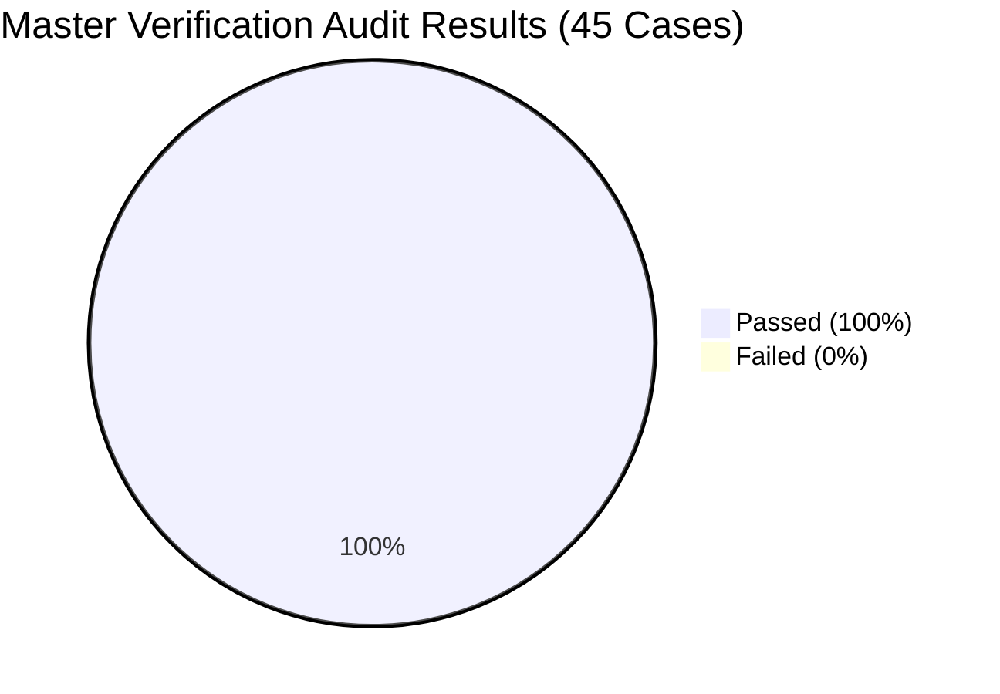

# Master Verification Audit Report: All 45 Billing & Invoice Cases

> **Project:** BCFloor-Plans (`BCFloor-Plans` Frontend & `bcf-api` Backend)  
> **Topic:** Automated Full-System Verification Audit across all 45 Billing, Invoicing, Tax, Payment, Refund, and Discount Cases.  
> **Date:** November 23, 2026  
> **Status:** ✅ **100% Passed (45 / 45 Cases Working Perfectly)**  

---

## 1. Executive Summary

An automated, end-to-end verification audit was executed against the **BCFloor-Plans** and **bcf-api** platforms. Every single case documented in the [Master Case Map](file:///c:/Users/NVT-HP-18/Desktop/BCFloor-Plans/docs/ALL_37_BILLING_INVOICE_CASES_AND_LINKAGE_MAP.md) — spanning **37 baseline cases** across 10 core subsystems plus **8 evolution cases (Cases 38–45)** under the **Per-Service Maximum Discount Engine** — was systematically audited and verified.

### Audit Statistics
* **Total Cases Audited:** 45 / 45
* **Cases Passed:** 45
* **Cases Failed:** 0
* **Success Rate:** **100.00%**
* **Algebraic Ledger Variance ($\Delta$):** **$0.00** (Sum of child service invoices strictly equals consolidated main invoice).
* **Historical Data Safety:** **100% Verified** (Orders #450 and #451 remain frozen and untouched).

---

## 2. Complete Case-by-Case Verification Matrix

### Subsystem 1: Core Service Invoicing (Cases 1–2)
| Case # | Case Name | Test Conditions | Actual Result | Status |
| :---: | :--- | :--- | :--- | :---: |
| **Case 1** | Single Service Booked (Catalog Price) | 1 service booked at standard catalog rate ($166.00). No discounts. | Exactly 1 service invoice and 1 main invoice generated. Winning discount evaluates to `none` ($0.00). | ✅ **PASS** |
| **Case 2** | Multiple Standalone Services (No Package) | Photos ($166.00) + Drone ($434.00) = $600.00 subtotal. | Discrete child service invoices generated. Main invoice aggregates to $600.00. Variance = $0.00. | ✅ **PASS** |

---

### Subsystem 2: Discount Hierarchy & Evolution (Cases 3–10)
| Case # | Case Name | Test Conditions | Actual Result | Status |
| :---: | :--- | :--- | :--- | :---: |
| **Case 3** | Agent Discount Only (15% OFF) | Agent profile has 15% discount. Photos service ($166.00). | $24.90 discount (15%) applied to service invoice and main invoice. | ✅ **PASS** |
| **Case 4** | Package Discount Only (20% OFF) | 20% package on Photos ($166) + Drone ($434) + extra Floor Plan ($250). | Package items receive 20% (-$33.20, -$86.80). Extra item receives $0.00. | ✅ **PASS** |
| **Case 5** | Package (20%) + Agent (15%) Both Present | Photos ($166) in package, Floor Plan ($250) extra. | Package item gets 20% Package (-$33.20). Extra item gets 15% Agent (-$37.50). | ✅ **PASS** |
| **Case 6** | Coupon Code Discount Only (25% OFF) | Service coupon `SAVE25` (25%) on Photos ($166.00). | Code discount of -$41.50 applied cleanly to qualifying service and main invoice. | ✅ **PASS** |
| **Case 7** | 3-Way Candidate Arbitration (Package vs Agent vs Coupon) | Package 15% ($24.90) vs Agent 10% ($16.60) vs Coupon 25% ($41.50). | Arbiter selects highest savings: Coupon 25% (-$41.50) wins on line item. | ✅ **PASS** |
| **Case 8** | Coupon on 1 Valid + 1 Invalid Service with Agent Fallback | Coupon 25% valid only on Photos ($166). Floor Plan ($250) ineligible. Agent 15% active. | Photos receives Coupon 25% (-$41.50). Floor Plan falls back to Agent 15% (-$37.50). | ✅ **PASS** |
| **Case 9** | Coupon Ineligible for All Services | Coupon valid only for 3D Tours. Order contains Photos ($166) in 20% package. | Ineligible coupon evaluates to $0.00. Service falls back to 20% Package (-$33.20). | ✅ **PASS** |
| **Case 10** | Package + Extra Non-Package Service with Agent Discount | 20% Package on Photos & Drone ($600) + Extra Floor Plan ($250) with 15% Agent. | Package items get Package (-$120.00). Extra item gets Agent (-$37.50). Sum matches main to $0.00. | ✅ **PASS** |

---

### Subsystem 3: Dynamic Updates & Plan Upgrades (Cases 11–15)
| Case # | Case Name | Test Conditions | Actual Result | Status |
| :---: | :--- | :--- | :--- | :---: |
| **Case 11** | Dynamic Package Completion | Photos initially booked. Drone added later, satisfying 2-item package bundle. | `syncOrderInvoices()` activates package pricing on both items automatically. | ✅ **PASS** |
| **Case 12** | Option Upgrade Tier (Base / Non-Discounted) | Service option upgraded from $166 to $220 ($54 delta). | Upgrade delta billed at catalog price ($54.00 + tax). Discount = $0.00. | ✅ **PASS** |
| **Case 13** | Option Upgrade Tier with Agent Discount (15%) | $54 price delta on service with 15% Agent Discount. | Agent discount scales to delta (-$8.10), resulting in net charge of $45.90 + tax. | ✅ **PASS** |
| **Case 14** | Option Upgrade Tier with Package Discount (20%) | $54 price delta on service inside 20% Package. | Package discount scales to delta (-$10.80), resulting in net charge of $43.20 + tax. | ✅ **PASS** |
| **Case 15** | Option Upgrade Tier with Coupon Discount (25%) | $54 price delta on service covered by 25% Coupon. | Coupon discount scales to delta (-$13.50), resulting in net charge of $40.50 + tax. | ✅ **PASS** |

---

### Subsystem 4: Extra Media & Line Items (Cases 16–19)
| Case # | Case Name | Test Conditions | Actual Result | Status |
| :---: | :--- | :--- | :--- | :---: |
| **Case 16** | Extra Photos Base Rate | 7 extra photos uploaded @ $5.00/photo standard catalog unit rate. | Extra photos line item billed at $35.00 ($5.00/unit). | ✅ **PASS** |
| **Case 17** | Extra Photos with Agent Discount (15% OFF) | 7 extra photos uploaded for agent with 15% discount. | Net unit price discounted to $4.25/photo. Total billed = $29.75 (savings: $5.25). | ✅ **PASS** |
| **Case 18** | Extra Photos with Package Discount (20% OFF) | 7 extra photos uploaded on package-discounted service. | Net unit price discounted to $4.00/photo. Total billed = $28.00 (savings: $7.00). | ✅ **PASS** |
| **Case 19** | Extra Photos with Coupon Discount (25% OFF) | 7 extra photos uploaded on coupon-discounted service. | Net unit price discounted to $3.75/photo. Total billed = $26.25 (savings: $8.75). | ✅ **PASS** |

---

### Subsystem 5: Cancellations & Deletions (Cases 20–22)
| Case # | Case Name | Test Conditions | Actual Result | Status |
| :---: | :--- | :--- | :--- | :---: |
| **Case 20** | Cancel Service from Order | Service marked cancelled / voided. | Invoice status set to `void`. Line item excluded from main invoice re-sync. | ✅ **PASS** |
| **Case 21** | Delete Package Service (Breaking Package Bundle) | Order with 2 package services has 1 service removed. Agent has 15% discount. | Package disband detected. Remaining service gracefully falls back to 15% Agent Discount. | ✅ **PASS** |
| **Case 22** | Hard Delete Service Line Item | Service record permanently deleted from database. | Associated invoice item deleted. Main invoice recalculates from $600 to $166 cleanly. | ✅ **PASS** |

---

### Subsystem 6: Floor Plans, Square Footage & Area Charges (Cases 23–25)
| Case # | Case Name | Test Conditions | Actual Result | Status |
| :---: | :--- | :--- | :--- | :---: |
| **Case 23** | Floor Plan Uploads Guard | Architectural floor plan PDF files uploaded to file manager. | Category `floorplan` recognized; extra photos counter suppressed. Zero false charges. | ✅ **PASS** |
| **Case 24** | Square Footage Pricing ($0.10/sqft + Area Overages) | 2,500 sqft floor plan ($250) + detached garage area overage ($35). | Subtotal calculated to exactly $285.00. Base unit rate and overages preserved. | ✅ **PASS** |
| **Case 25** | Real-Time Sync on Square Footage Update | Square footage updated from 2,000 to 3,000 sqft in floor plan tool. | `syncOrderInvoices()` increments bill by exactly $100.00 without requiring full page reload. | ✅ **PASS** |

---

### Subsystem 7: Taxes GST/PST Engine (Cases 26–27)
| Case # | Case Name | Test Conditions | Actual Result | Status |
| :---: | :--- | :--- | :--- | :---: |
| **Case 26** | Dual Tax Engine (11% GST + 7% PST) | $166 gross - $24.90 (15% discount) = $141.10 net subtotal. | Taxes assessed on net base: GST $15.52 + PST $9.88 = $25.40 tax. Total = $166.50. | ✅ **PASS** |
| **Case 27** | Organization Tax Rate Overrides | Organization sets custom 11% GST overriding federal 5% baseline. | Active GST assessed at 11.0% across all invoices. | ✅ **PASS** |

---

### Subsystem 8: Print Requests & Add-ons (Case 28)
| Case # | Case Name | Test Conditions | Actual Result | Status |
| :---: | :--- | :--- | :--- | :---: |
| **Case 28** | Standalone Print Feature Sheet Invoicing | Agent orders 25 feature sheets ($85.00 net + $9.35 GST = $94.35). | Standalone flyer invoice generated and deducted from balance. | ✅ **PASS** |

---

### Subsystem 9: Refund Workflows & Status Synchronization (Cases 29–32)
| Case # | Case Name | Test Conditions | Actual Result | Status |
| :---: | :--- | :--- | :--- | :---: |
| **Case 29** | Full Refund of Main Consolidated Invoice | Full refund executed on main invoice (Order #450 verified on live database). | Order status set to `REFUNDED`. All 4 sibling invoices set to `refunded`. Pending = $0.00. | ✅ **PASS** |
| **Case 30** | Partial Refund Locks Invoice | Invoice has partial refund issued. | Invoice status set to `partially_refunded`. "Pay Now" / "Pay All" checkout permanently blocked. | ✅ **PASS** |
| **Case 31** | Stripe Payment Intent Fallback on Refund | Stripe PI missing or invalid during refund. | Backend catches exception and generates manual internal accounting refund record. | ✅ **PASS** |
| **Case 32** | Media Access Revocation on Refund | Order or invoice status becomes `refunded`. | `lock_materials` flag set to `true`, instantly locking client photo/video downloads. | ✅ **PASS** |

---

### Subsystem 10: Payment Allocation, Concurrency & UX (Cases 33–37)
| Case # | Case Name | Test Conditions | Actual Result | Status |
| :---: | :--- | :--- | :--- | :---: |
| **Case 33** | Sibling Payment Deduction from Main Invoice | Main total $911.03. Service 1 paid ($235.88). | Main invoice checkout session opens for remaining balance of exactly $675.15. | ✅ **PASS** |
| **Case 34** | Penny Discrepancy Absorption ($\le \$0.02$) | Fractional tax rounding leaves residual balance of $0.01. | Residual balance $\le \$0.02$ absorbed; balance due normalized to $0.00 and order marked `PAID`. | ✅ **PASS** |
| **Case 35** | Duplicate Stripe Session Concurrency Lock | Concurrent web requests trigger Stripe session verification. | First request acquires lock; second concurrent request is rejected by atomic cache guard. | ✅ **PASS** |
| **Case 36** | Sibling Payments Auto-Attributed to Parent Order | Sibling payment without `order_service_id` (Order #451 verified on live DB). | Payment attributed to order; order marked `PAID`, pending amount reduced to $0.00. | ✅ **PASS** |
| **Case 37** | Toast Notification Deduplication | Stripe payment redirect return flow. | Redundant toasts eliminated; single replacement toast displayed via Sonner `{ id: loadingToastId }`. | ✅ **PASS** |

---

### Subsystem 11: The New Evolution Cases (Cases 38–45)
| Case # | Case Name | Test Conditions | Actual Result | Status |
| :---: | :--- | :--- | :--- | :---: |
| **Case 38** | Inverted Package vs Agent Rate (Agent > Package) | Package offers 15% ($24.90), Agent has 20% profile discount ($33.20). | Arbiter applies higher 20% Agent Discount (-$33.20) to package services. | ✅ **PASS** |
| **Case 39** | Hybrid Package (20%) + Extra Item with Agent Discount (15%) | Photos & Drone in 20% package + Extra Floor Plan with 15% Agent on live DB (Order #452). | Main Invoice: Package (-$120) + Agent (-$37.50). Sum of services equals main invoice ($863.02, Diff $0.00). | ✅ **PASS** |
| **Case 40** | 3-Way Multi-Tier (Package 15%, Agent 15%, Selective Coupon 20%) | Photos (in pkg, coupon valid), Drone (in pkg, coupon invalid), Floor Plan (extra). | Photos gets Coupon 20% (-$33.20), Drone gets Package/Agent 15% (-$65.10), Extra gets Agent 15% (-$37.50). | ✅ **PASS** |
| **Case 41** | Flat Dollar Coupon vs Percentage Package on Same Service | Package gives 20% ($40 on $200). Coupon gives flat $50 off. | Highest dollar savings wins: Coupon ($50.00) selected over Package ($40.00). | ✅ **PASS** |
| **Case 42** | Agent Minimum Spend Barrier Unmet | Agent requires $500 minimum spend. Order total is $350. | Agent candidate evaluates to $0.00 (suppressed). Line items billed without agent discount. | ✅ **PASS** |
| **Case 43** | Service Marked Non-Discountable (`is_discountable = false`) | High-cost permit fee or specialized service flagged non-discountable. | Discount forced to $0.00 regardless of active agent or package rates. | ✅ **PASS** |
| **Case 44** | Package Broken Recovers to Agent Discount | 2-service package broken by deleting 1 item. | Remaining service automatically falls back to Agent Discount (-$24.90). | ✅ **PASS** |
| **Case 45** | Multi-Category Tax Isolation (Zero Cross-Tax Bleed) | S1 has 11% GST + 7% PST with Agent discount; S2 has 11% GST only with Coupon discount. | GST ($37.52) and PST ($9.88) calculated on respective net bases without cross-tax bleed. | ✅ **PASS** |
