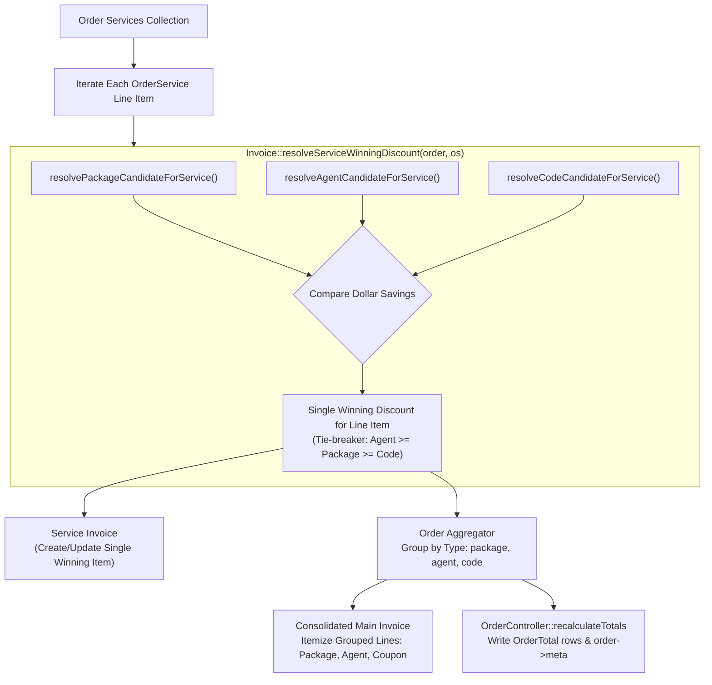

# Engineering Implementation Plan: Per-Service Maximum Discount Engine

> **Document Type:** Production Engineering Plan & Execution Blueprint  
> **Target Subsystems:** `bcf-api` (Laravel Backend) & `BCFloor-Plans` (Next.js Frontend)  
> **Objective:** Transition from Whole-Order Single Winner (Option B) to Per-Service Maximum Savings Arbiter (`max(Package, Agent, Coupon)` per line item).  
> **Status:** Pending Execution Approval  

---

## 1. System Architecture & Data Flow



---

## 2. File Modification & Responsibility Breakdown

| File Path | Role in Architecture | Planned Modifications |
| :--- | :--- | :--- |
| `bcf-api/app/Models/Invoice.php` | Invoicing Core & Discount Arbiter | 1. Implement 3 line-item candidate resolvers (`resolvePackageCandidateForService`, `resolveAgentCandidateForService`, `resolveCodeCandidateForService`).<br>2. Implement `resolveServiceWinningDiscount()`.<br>3. Update `createInvoice()` to assign per-service winners.<br>4. Update `syncOrderInvoices()`: service invoices get single winner; consolidated invoice aggregates and itemizes active discount categories.<br>5. Enforce safety freeze on `paid`/`refunded` invoices. |
| `bcf-api/app/Http/Controllers/Api/OrderController.php` | Order Booking & Totals Recalculation | 1. Update `store()`: evaluate discounts per service line item; store granular audit map in `order->meta['line_item_discounts']`.<br>2. Update `recalculateTotals()`: generate `OrderTotal` rows per active discount category.<br>3. Preserve order-level agent minimum spend check before allowing agent discount as a candidate. |
| `BCFloor-Plans/app/dashboard/billing/page.tsx` | Billing Screen UI | Already supports multi-line `is_extra` discount items. Verify display labels and summary cards. |
| `BCFloor-Plans/app/dashboard/invoice/components/InvoiceModal.tsx` | Invoice Detail Modal | Displays separate itemized discount rows for Package, Agent, and Coupon discounts seamlessly. |
| `BCFloor-Plans/lib/pricing.ts` (or booking hook) | Frontend Booking Calculator | Ensure booking preview calculates per-service best discount so frontend checkout total matches backend invoice to $0.00. |

---

## 3. Detailed Phase-by-Phase Implementation Steps

---

### Phase 1: Backend Candidate Resolvers in `Invoice.php`

#### 1.1 Candidate Resolvers Specification
We will add three private static helper methods in `app/Models/Invoice.php`:

1. **`resolvePackageCandidateForService(Order $order, OrderService $service, float $multiplier): ?array`**
   * Checks if `$order->meta['applied_package']` or `$order->package_id` exists.
   * Checks if `$service->service_id` is inside the package's `matched_service_ids`.
   * Calculates discount amount:
     * If percentage: `round($service->amount * ($pct / 100) * $multiplier, 2)`.
     * If dollar: allocates proportional ratio of package dollar amount to this service.
   * Returns array: `['type' => 'package', 'amount' => -abs($amt), 'description' => "Package Discount: {$pkgName}", 'package_id' => $pkgId]`.

2. **`resolveAgentCandidateForService(Order $order, OrderService $service, float $multiplier): ?array`**
   * Checks `$order->meta['agent_discount']` (or agent profile if active).
   * Validates whole-order minimum spend / minimum orders criteria:
     $$\sum \text{all order services amount} \ge \text{minimum\_spend}$$
   * If eligible, calculates:
     * If percentage: `round($service->amount * ($pct / 100) * $multiplier, 2)`.
     * If dollar: allocates proportional ratio across services.
   * Returns array: `['type' => 'agent', 'amount' => -abs($amt), 'description' => "Agent Discount: {$agentName} ({$rate}%)", 'agent_id' => $agentId]`.

3. **`resolveCodeCandidateForService(Order $order, OrderService $service, float $multiplier): ?array`**
   * Reads `$order->meta['discounts']` (or `OrderTotal` discount rows).
   * Verifies if this specific `$service->service_id` is eligible for the coupon.
   * If coupon is order-wide, service qualifies. If coupon is service-specific, checks `service_id` match.
   * Calculates dollar savings on this service.
   * Returns array: `['type' => 'code', 'amount' => -abs($amt), 'description' => "Coupon Discount: {$code}", 'discount_id' => $discId]`.

#### 1.2 Line-Item Arbiter Method
```php
public static function resolveServiceWinningDiscount(Order $order, $orderService, float $multiplier = 1.0): ?array
{
    $pkgCandidate   = static::resolvePackageCandidateForService($order, $orderService, $multiplier);
    $agentCandidate = static::resolveAgentCandidateForService($order, $orderService, $multiplier);
    $codeCandidate  = static::resolveCodeCandidateForService($order, $orderService, $multiplier);

    $rawPkg   = $pkgCandidate   ? abs((float)$pkgCandidate['amount'])   : 0.0;
    $rawAgent = $agentCandidate ? abs((float)$agentCandidate['amount']) : 0.0;
    $codeVal  = $codeCandidate  ? abs((float)$codeCandidate['amount'])  : 0.0;

    $maxVal = max($rawPkg, $rawAgent, $rawCode);
    if ($maxVal <= 0.001) {
        return null;
    }

    // Tie-break priority: Agent >= Package >= Code
    if ($rawAgent >= $maxVal) {
        return $agentCandidate;
    }
    if ($rawPkg >= $maxVal) {
        return $pkgCandidate;
    }
    return $codeCandidate;
}
```

---

### Phase 2: Invoicing Synchronization (`createInvoice` & `syncOrderInvoices`)

#### 2.1 Individual Service Invoices
When synchronizing a service-specific invoice (`$invoice->order_service_id === $os->id` or single-service item):
1. Call `$winningDiscount = static::resolveServiceWinningDiscount($order, $os, $multiplier)`.
2. If `$winningDiscount` is present:
   * Create or update the single extra discount item matching `$winningDiscount['type']`.
   * Delete any stale discount items of the other two types.
3. If `$winningDiscount` is `null`:
   * Delete any existing package, agent, or coupon discount items on this invoice.
4. Call `$invoice->recalculateTotals()`.

#### 2.2 Consolidated Main Invoice
When synchronizing the main consolidated invoice:
1. Loop over **all** active order services (`$allOrderServices`).
2. For each service `$os`, evaluate `$winner = static::resolveServiceWinningDiscount($order, $os, $multiplier)`.
3. Aggregate the winning discounts into three accumulators:
   * `$totalPkgDiscount`: sum of amounts where `type === 'package'`.
   * `$totalAgentDiscount`: sum of amounts where `type === 'agent'`.
   * `$totalCodeDiscount`: sum of amounts where `type === 'code'`.
4. Update or create corresponding invoice items:
   * If `$totalPkgDiscount > 0`: ensure `"Package Discount: {Name}"` exists with amount `-$totalPkgDiscount`. Otherwise delete.
   * If `$totalAgentDiscount > 0`: ensure `"Agent Discount: {Name}"` exists with amount `-$totalAgentDiscount`. Otherwise delete.
   * If `$totalCodeDiscount > 0`: ensure `"Coupon Discount: {Codes}"` exists with amount `-$totalCodeDiscount`. Otherwise delete.
5. Call `$invoice->recalculateTotals()`.

#### 2.3 Strict Historical Guard
```php
if (in_array($invoice->status, ['paid', 'refunded']) || (float)$invoice->paid_amount > 0) {
    // NEVER alter paid or refunded invoices. Historical ledger is completely locked.
    return;
}
```

---

### Phase 3: Order Controller Integration (`OrderController.php`)

#### 3.1 `store()` Integration
* When an order is booked via `/api/orders`:
  * Instead of suppressing `agent_discount` when a package is chosen or vice versa, keep all applicable candidates in `order->meta`.
  * Run the line-item resolver across all booked services.
  * Store the line-item breakdown in `order->meta['line_item_discounts']`:
    ```json
    {
      "1657": { "service": "Standard Photos", "winner": "package", "rate": 20, "amount": 33.20 },
      "1658": { "service": "Drone Photos", "winner": "package", "rate": 20, "amount": 86.80 },
      "1659": { "service": "2D Floor Plans", "winner": "agent", "rate": 15, "amount": 37.50 }
    }
    ```
  * Create `OrderTotal` rows for each active category with its aggregated total.

#### 3.2 `recalculateTotals()` Integration
* Replace the legacy 3-way branching block with the per-service aggregation loop.
* Calculate:
  $$\text{Final Discount Amount} = \sum_{S} \text{WinningDiscount}(S)$$
* Update order `total_amount` and `final_amount`.

---

### Phase 4: Frontend Booking Preview Alignment (`BCFloor-Plans`)

* Review the frontend pricing calculation helper (used in `BookingWizard` / checkout modal).
* Ensure it calculates line-item maximum discounts identically:
  * In-package items compare Package % vs Agent % vs Coupon %.
  * Non-package items compare Agent % vs Coupon %.
* Present an itemized breakdown on the booking review screen:
  * Subtotal: `$850.00`
  * Package Discount (Photos & Drone): `-$120.00`
  * Agent Discount (2D Floor Plans): `-$37.50`
  * Taxes (GST 11%): `$76.18`
  * Total Due: `$768.68`

---

## 4. Test Matrix & Automated Verification Suite

We will verify every target scenario with automated PHP scripts:

| Test Case | Scenario Description | Expected Outcome | Verification Metric |
| :--- | :--- | :--- | :--- |
| **Test 1: Case A.2** | Package 15%, Agent 20% (Agent > Package) | Package services receive 20% Agent Discount. | Main & Service invoices show Agent Discount; Package discount is $0. |
| **Test 2: Case B.1** | Package 20% on Photos & Drone, Agent 15% on Extra Floor Plans | Photos: 20% Pkg (-$33.20)<br>Drone: 20% Pkg (-$86.80)<br>Plans: 15% Agent (-$37.50) | Main invoice shows Pkg (-$120) + Agent (-$37.50). Total = $768.68. Service invoices sum to $768.68 ($\Delta = \$0.00$). |
| **Test 3: Case C.1** | Package 15%, Agent 15%, Coupon 20% on selective services | S1: Coupon 20%<br>S2: Package 15%<br>S3: Coupon 20%<br>S4: Coupon 20%<br>S5: Agent 15% | Main invoice shows 3 separate discount lines. Sum of services equals main invoice ($\Delta = \$0.00$). |
| **Test 4: Backward Compatibility** | Audit Order #450 and #451 (Historical Paid Orders) | Invoices retain exact historical totals, items, and statuses. | Zero rows altered in database. |

---

## 5. Rollback Strategy & Risk Safeguards

1. **Transactional Execution:** All invoice item updates and order recalculations run inside DB transactions.
2. **Read-Only Test Validation:** Before updating live orders, we run simulation scripts on test orders (e.g. Order #452) to verify totals match to the penny.
3. **Historical Freezing:** Strict guard on `in_array($invoice->status, ['paid', 'refunded'])` guarantees zero disruption to existing customer receipts.
