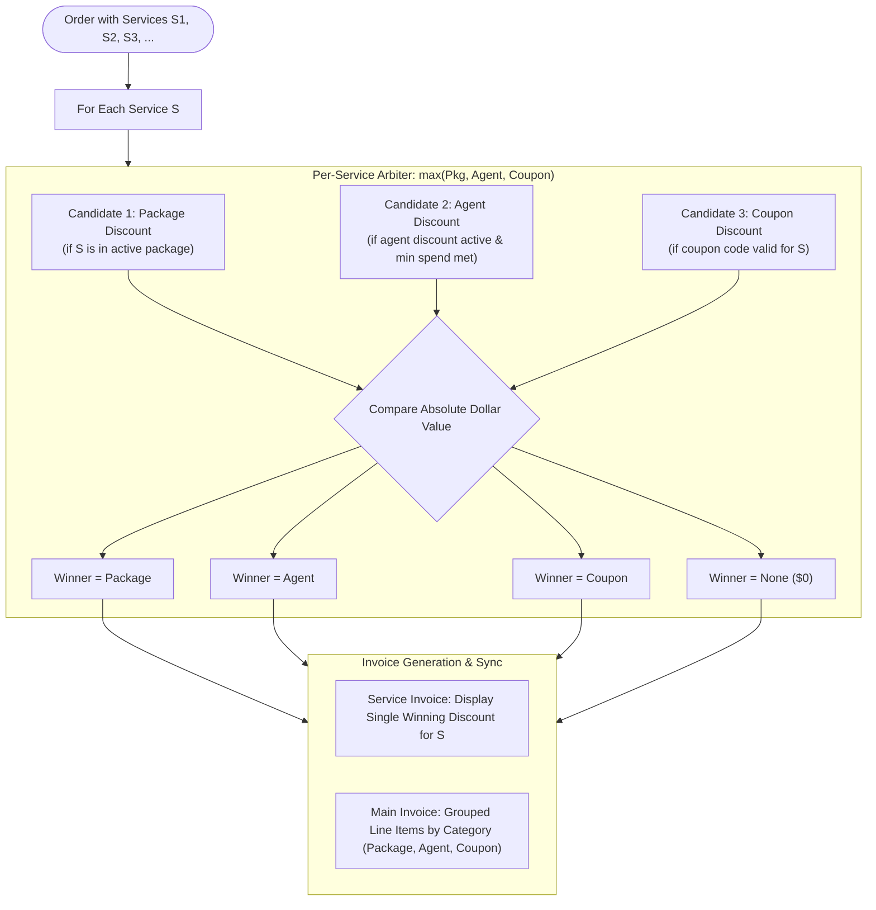
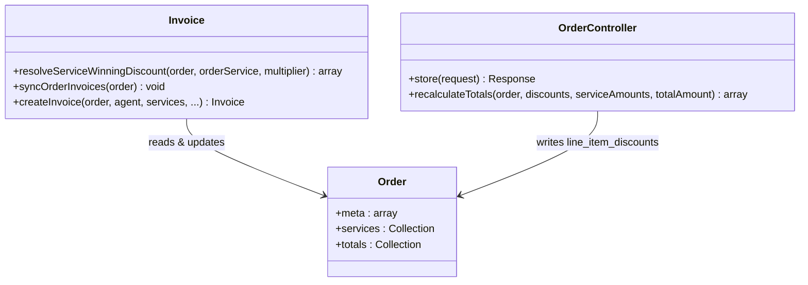
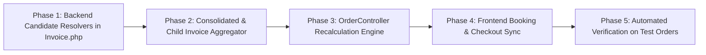

# Per-Service Maximum Discount Engine: Complete Case Matrix & Implementation Plan

> **Objective:** Transition to a true **Per-Service Best Discount Engine** where every single line item independently receives the **highest available discount it qualifies for**, maximizing customer savings across Package, Agent, and Coupon discounts without stacking on a single item.

---

## 1. The Core Principle: Line-Item Maximum Savings Arbiter

For every service item ($S$) on an order:
$$\text{Discount}(S) = \max \Big( \text{PackageCandidate}(S),\, \text{AgentCandidate}(S),\, \text{CouponCandidate}(S) \Big)$$

* **Rule 1 (No Stacking on a Single Service):** Exactly **one** winning discount applies to any individual service line item.
* **Rule 2 (Independent Line-Item Winners):** Different services within the *same* order can have different discount types (e.g. Service A gets Package, Service B gets Coupon, Service C gets Agent).
* **Rule 3 (Consolidated Aggregation):** The Consolidated Main Invoice groups and sums the discounts by category into distinct line items.
* **Rule 4 (Mathematical Equality):** The sum of all individual service invoices equals the consolidated main invoice to the exact penny ($0.00 difference).



---

## 2. Exhaustive Case Catalog & Expected Results

---

### Group A: Package Services Only (No Extra Services)

#### Case A.1: Package Rate Higher Than Agent Rate
* **Scenario:** Package offers **20%**; Agent profile has **15%**. No coupon code.
  * Standard Photos ($166) $\rightarrow$ Package ($33.20) vs Agent ($24.90) $\rightarrow$ **Package (20%) wins**.
  * Drone Photos ($434) $\rightarrow$ Package ($86.80) vs Agent ($65.10) $\rightarrow$ **Package (20%) wins**.
* **Invoice Output:**
  * Invoice (Photos): Shows `Package Discount (20%): -$33.20`.
  * Invoice (Drone): Shows `Package Discount (20%): -$86.80`.
  * Main Invoice: Shows `Package Discount: Photo & Drone (-$120.00)`. Agent discount is $0.

#### Case A.2: Agent Rate Higher Than Package Rate (User Request Case 1)
* **Scenario:** Package offers **15%**; Agent profile has **20%**. No coupon code.
  * Standard Photos ($166) $\rightarrow$ Package ($24.90) vs Agent ($33.20) $\rightarrow$ **Agent (20%) wins**.
  * Drone Photos ($434) $\rightarrow$ Package ($65.10) vs Agent ($86.80) $\rightarrow$ **Agent (20%) wins**.
* **Invoice Output:**
  * Customer gets the **higher** discount (20% instead of 15%).
  * Invoice (Photos): Shows `Agent Discount (20%): -$33.20`.
  * Invoice (Drone): Shows `Agent Discount (20%): -$86.80`.
  * Main Invoice: Shows `Agent Discount: Name (20%) (-$120.00)`. Package discount is $0.

#### Case A.3: Package Rate Equal to Agent Rate (Tie-Break)
* **Scenario:** Package offers **15%**; Agent profile has **15%**.
  * Both discounts yield identical savings.
* **Invoice Output:**
  * Resolved by tie-breaking priority (**Agent Discount** wins by default as personal relationship rate).
  * Invoices display `Agent Discount (15%)`.

#### Case A.4: Package (15%), Agent (15%), and Coupon Code (20%) on All Services
* **Scenario:** Package is 15%, Agent is 15%, customer enters Coupon `SAVE20` giving 20% on all services.
  * For all services: Coupon (20%) > Package (15%) and Agent (15%).
* **Invoice Output:**
  * All service invoices and main invoice apply `Coupon Discount: SAVE20 (20%)`.

#### Case A.5: Package (15%), Agent (15%), and Coupon (20%) Valid on Only One Package Service
* **Scenario:** Package has Photos ($166) and Drone ($434). Coupon `PHOTO20` gives 20% on Photos only.
  * Photos ($166): Coupon ($33.20) > Package ($24.90) and Agent ($24.90) $\rightarrow$ **Coupon (20%) wins**.
  * Drone ($434): Coupon is invalid ($0). Package ($65.10) vs Agent ($65.10) $\rightarrow$ **Agent / Package (15%) wins**.
* **Invoice Output:**
  * Invoice (Photos): Shows `Coupon Discount: PHOTO20 (-$33.20)`.
  * Invoice (Drone): Shows `Package Discount (15%) (-$65.10)` (or Agent).
  * Main Invoice: Shows **two** distinct discount lines:
    * `Coupon Discount: PHOTO20 (-$33.20)`
    * `Package Discount: Photo Package (-$65.10)`
  * Total discount: **-$98.30**.

---

### Group B: Package Services + Extra Services (No Coupon)

#### Case B.1: Package Rate Higher Than Agent Rate (Current Order #452 Scenario)
* **Scenario:** Package has Photos ($166) and Drone ($434) with **20% Package Discount**. Extra service: 2D Floor Plans ($250). Agent has **15% Agent Discount**.
  * Photos ($166): Package ($33.20) > Agent ($24.90) $\rightarrow$ **Package (20%) wins**.
  * Drone ($434): Package ($86.80) > Agent ($65.10) $\rightarrow$ **Package (20%) wins**.
  * 2D Floor Plans ($250): Not in package (Package = $0). Agent (15% = $37.50) $\rightarrow$ **Agent (15%) wins**.
* **Invoice Output:**
  * Invoice (Photos): Subtotal $132.80 (Package Disc: -$33.20) + Tax $14.61 = **$147.41**.
  * Invoice (Drone): Subtotal $347.20 (Package Disc: -$86.80) + Tax $38.19 = **$385.39**.
  * Invoice (Floor Plans): Subtotal $212.50 (Agent Disc: -$37.50) + Tax $23.38 = **$235.88**.
  * Main Invoice:
    * Subtotal: $850.00
    * `Package Discount: Photo Package (20%)`: **-$120.00**
    * `Agent Discount: Testing Agent (15%)`: **-$37.50**
    * Net Subtotal: $692.50
    * Tax (11% GST): $76.18
    * Total Due: **$768.68**
  * Sum of Service Invoices: $\$147.41 + \$385.39 + \$235.88 = \mathbf{\$768.68} \equiv \text{Main Invoice}$ ($\Delta = \$0.00$).

#### Case B.2: Agent Rate Higher Than Package Rate with Extra Services
* **Scenario:** Package has Photos ($166) and Drone ($434) with **15% Package Discount**. Extra: 2D Floor Plans ($250). Agent has **20% Agent Discount**.
  * Photos ($166): Agent ($33.20) > Package ($24.90) $\rightarrow$ **Agent (20%) wins**.
  * Drone ($434): Agent ($86.80) > Package ($65.10) $\rightarrow$ **Agent (20%) wins**.
  * 2D Floor Plans ($250): Agent ($50.00) > Package ($0) $\rightarrow$ **Agent (20%) wins**.
* **Invoice Output:**
  * Agent discount wins on every single item.
  * All invoices show `Agent Discount (20%)`. Package discount is $0.
  * Total discount: -$170.00.

---

### Group C: Package Services + Extra Services + Coupon Code (Complex 3-Way Hybrid)

#### Case C.1: Multi-Service Selective Coupon (User Request Case 2)
* **Scenario:**
  * **Package Services (15% Package Discount):**
    * Service 1: Standard Photos ($166)
    * Service 2: Drone Photos ($434)
  * **Extra Services (Not in package):**
    * Service 3: 2D Floor Plans ($250)
    * Service 4: Video Tour ($300)
    * Service 5: Virtual Staging ($150)
  * **Discounts Active:**
    * Package: **15%** on S1 & S2.
    * Agent Discount: **15%** across all services.
    * Coupon Code `PROMO20`: **20%** valid only on S1 (Photos), S3 (Floor Plans), and S4 (Video). Invalid on S2 and S5.
* **Per-Service Evaluation:**

| Service | Base Price | Package Candidate | Agent Candidate | Coupon Candidate | Winning Discount | Net Price |
| :--- | :--- | :--- | :--- | :--- | :--- | :--- |
| **S1 (Photos, in pkg)** | $166.00 | 15% ($24.90) | 15% ($24.90) | **20% ($33.20)** | **Coupon 20% (-$33.20)** | $132.80 |
| **S2 (Drone, in pkg)** | $434.00 | **15% ($65.10)** | 15% ($65.10) | N/A ($0.00) | **Package 15% (-$65.10)** | $368.90 |
| **S3 (Floor Plans, extra)**| $250.00 | N/A ($0.00) | 15% ($37.50) | **20% ($50.00)** | **Coupon 20% (-$50.00)** | $200.00 |
| **S4 (Video, extra)** | $300.00 | N/A ($0.00) | 15% ($45.00) | **20% ($60.00)** | **Coupon 20% (-$60.00)** | $240.00 |
| **S5 (Staging, extra)** | $150.00 | N/A ($0.00) | **15% ($22.50)** | N/A ($0.00) | **Agent 15% (-$22.50)** | $127.50 |
| **TOTALS** | **$1,300.00**| | | | **Total Discount: -$230.80** | **$1,069.20** |

* **Invoice Aggregation Breakdown:**
  * **Invoice S1 (Photos):** Shows `Coupon Discount: PROMO20 (-$33.20)`.
  * **Invoice S2 (Drone):** Shows `Package Discount: Photo Package (-$65.10)`.
  * **Invoice S3 (Floor Plans):** Shows `Coupon Discount: PROMO20 (-$50.00)`.
  * **Invoice S4 (Video):** Shows `Coupon Discount: PROMO20 (-$60.00)`.
  * **Invoice S5 (Staging):** Shows `Agent Discount: Testing Agent (-$22.50)`.
  * **Main Consolidated Invoice:**
    * Base Subtotal: $1,300.00
    * `Coupon Discount: PROMO20`: **-$143.20** ($33.20 + $50.00 + $60.00)
    * `Package Discount: Photo Package (15%)`: **-$65.10**
    * `Agent Discount: Testing Agent (15%)`: **-$22.50**
    * Net Subtotal: **$1,069.20**
    * GST (11%): **$117.61**
    * Total Due: **$1,186.81**
  * **Sum of Service Invoices:** Exactly **$1,186.81** (Zero penny discrepancy).

#### Case C.2: High Fixed Dollar Coupon vs High Percentage Package
* **Scenario:** Package gives **20%** on a $200 service ($40 discount). Coupon offers flat **$50 off** on that service.
  * $50.00 Coupon > $40.00 Package $\rightarrow$ **Coupon ($50) wins**.
* **Invoice Output:** Service invoice and main invoice apply the $50 flat discount.

#### Case C.3: Agent Minimum Spend Not Met
* **Scenario:** Agent discount requires minimum spend of $500. Order total is $350.
  * Agent candidate is rejected ($0.00).
  * System evaluates only Package vs Coupon vs None on each service.

---

## 3. Technical Implementation Architecture



### 1. New Helper: `Invoice::resolveServiceWinningDiscount()`
Location: `bcf-api/app/Models/Invoice.php`
```php
public static function resolveServiceWinningDiscount(Order $order, $orderService, float $multiplier = 1.0): ?array
{
    // 1. Calculate Package Candidate for this service
    $pkgCandidate = static::resolvePackageCandidateForService($order, $orderService, $multiplier);
    
    // 2. Calculate Agent Candidate for this service
    $agentCandidate = static::resolveAgentCandidateForService($order, $orderService, $multiplier);
    
    // 3. Calculate Coupon Candidate for this service
    $codeCandidate = static::resolveCodeCandidateForService($order, $orderService, $multiplier);
    
    // 4. Compare absolute dollar savings
    $pkgVal   = $pkgCandidate   ? abs((float)$pkgCandidate['amount'])   : 0.0;
    $agentVal = $agentCandidate ? abs((float)$agentCandidate['amount']) : 0.0;
    $codeVal  = $codeCandidate  ? abs((float)$codeCandidate['amount'])  : 0.0;
    
    $maxVal = max($pkgVal, $agentVal, $codeVal);
    if ($maxVal <= 0.001) {
        return null;
    }
    
    // Tie-break priority: Agent >= Package >= Code
    if ($agentVal >= $maxVal) {
        return $agentCandidate;
    }
    if ($pkgVal >= $maxVal) {
        return $pkgCandidate;
    }
    return $codeCandidate;
}
```

### 2. Updating `syncOrderInvoices()`:
* **For Service Invoices:**
  Calls `resolveServiceWinningDiscount($order, $os, $multiplier)`. If null, removes any existing discount items. If present, creates or updates the specific discount item with metadata `['type' => 'package_discount'|'agent_discount'|'code_discount']`.
* **For Consolidated Main Invoice:**
  Loops over all active order services, evaluates `resolveServiceWinningDiscount()`, and aggregates by category:
  * Sum of package discounts $\rightarrow$ Creates/updates `"Package Discount: {Name}"` line.
  * Sum of agent discounts $\rightarrow$ Creates/updates `"Agent Discount: {Name} ({Rate}%)"` line.
  * Sum of coupon discounts $\rightarrow$ Creates/updates `"Coupon Discount: {Codes}"` line.
  * Automatically removes lines where the category sum is zero.

### 3. Updating `OrderController.php` (`store()` and `recalculateTotals()`):
* Iterates through the order's services and runs the line-item resolver.
* Populates `OrderTotal` rows for each active discount category.
* Stores the detailed audit map in `order->meta['line_item_discounts']` and the category totals in `order->meta`.

### 4. Historical Data Freezing (Safeguard):
```php
if (in_array($invoice->status, ['paid', 'refunded']) || (float)$invoice->paid_amount > 0) {
    // Completely skip recalculation to protect historical receipts
    return;
}
```

---

## 4. Phase-by-Phase Execution Roadmap



* **Phase 1: Candidate Resolvers**
  Implement `resolvePackageCandidateForService()`, `resolveAgentCandidateForService()`, and `resolveCodeCandidateForService()` in `Invoice.php`.
* **Phase 2: Aggregator & Child Sync**
  Update `Invoice::syncOrderInvoices()` to manage the multi-category consolidated lines and child invoice single-winner lines.
* **Phase 3: Order Controller Integration**
  Update `OrderController::store()` and `recalculateTotals()` to match the line-item engine.
* **Phase 4: Frontend Alignment**
  Update `BCFloor-Plans` booking summary hook so customer sees the exact same multi-line itemized savings before checkout.
* **Phase 5: Matrix Testing**
  Run automated test scripts covering Case A.1 through C.3. Confirm sum of service invoices matches main invoice to $0.00 across all cases.
